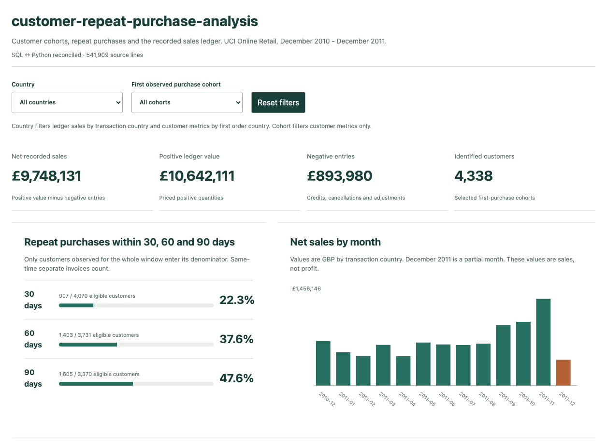
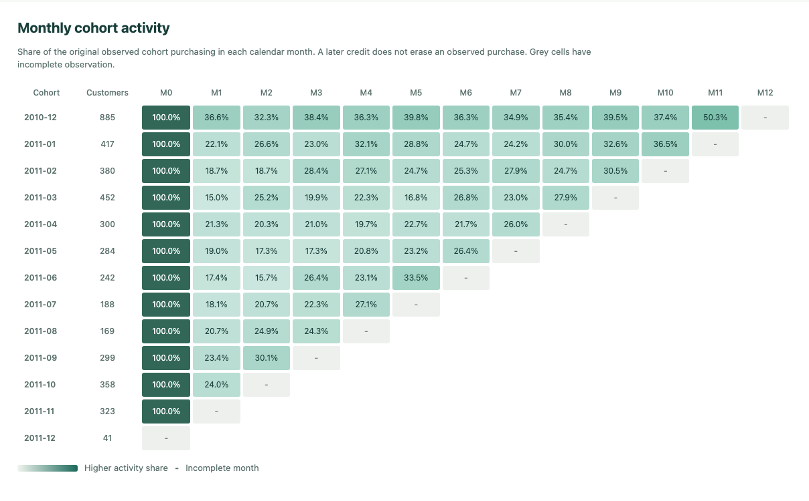

[English](README.md) | [Italiano](README.it.md)

# customer-repeat-purchase-analysis

An inspectable Python + SQL analysis of repeat purchases, customer cohorts, cancellations and recorded net sales using the public UCI Online Retail workbook. DuckDB stores the cleaned ledger locally. A small static dashboard explores reviewed results without a frontend build or external services.



The workbook records **£9.75m in net sales** and **4,338 identified purchasing customers**. Among customers with a full 30-day observation window, **907 of 4,070 (22.3%)** purchased on another invoice. These are historical results, not profit or predicted business uplift.



Each row follows customers from their first observed purchase month. Cells show the share who purchased in a later calendar month; grey cells have incomplete observation. Country and cohort filters support exploration of individual customer groups. [Open the full desktop view](reports/qa-desktop.png) or [see the mobile layout](reports/qa-mobile.png).

## Questions answered

- Which first-observed purchase cohorts come back, and in which calendar months?
- How many customers buy on another invoice within 30, 60 and 90 elapsed days, with fair observation windows?
- How do priced negative entries affect net recorded sales, and how much evidence links them to earlier positive lines?
- How do missing IDs, duplicates, invalid prices and incomplete months change the usable population?

## Run the demo with the included results

Clone the repository into the directory name used by these instructions, or use your existing local project folder:

```bash
git clone https://github.com/Gr1gorii/customer-repeat-purchase-analysis.git retail-cohort-analytics
cd retail-cohort-analytics
python3 -m http.server 8764 --bind 127.0.0.1
```

Open **http://127.0.0.1:8764/web/**. Keep the server bound to loopback. No external API, account, cloud service or paid dependency is needed. Use country and first-purchase cohort filters; reset returns the baseline. Cohort filters affect customer metrics only, as explained in the UI. Sales use transaction country; customer metrics use the country of the first observed purchase. Stop the server with Ctrl+C.

## Reproduce from the original source

Python 3.11 was used. Runtime dependencies are DuckDB, pandas and openpyxl; development tools are pytest, Ruff and optional Playwright. The complete tested environment is pinned in `requirements.lock`.

Run these commands from the project directory:

```bash
python3 -m venv .venv
.venv/bin/python -m pip install -r requirements.lock
PYTHONPATH=src .venv/bin/python -m retail.pipeline
.venv/bin/python -m pytest -q
.venv/bin/ruff check src tests scripts
.venv/bin/ruff format --check src tests scripts
```

The first pipeline run downloads ~23 MB from UCI, extracts the exact workbook member, records hashes, cleans 541,909 lines, rebuilds `data/processed/retail.duckdb`, exports the cleaned Parquet audit ledger and regenerates CSV/JSON/English management summary. Subsequent runs reuse the local source ZIP and rebuild outputs; no duplicate accumulation. Expect roughly 20-45 seconds for Excel parsing on a laptop. If download fails, retry when network access is available; no substituted or fabricated dataset is used. Raw data, database, Parquet and `.venv` are gitignored; the small reviewed aggregates/demo are included.

For optional browser QA:

```bash
PLAYWRIGHT_BROWSERS_PATH=/tmp/retail-playwright .venv/bin/playwright install chromium
PLAYWRIGHT_BROWSERS_PATH=/tmp/retail-playwright .venv/bin/python scripts/browser_qa.py
```

The test starts a temporary loopback server, runs desktop/mobile/filter/empty-state/repeated-action/error-state checks, saves screenshots and shuts it down. Browser execution may require local sandbox permission. The normal demo does not require Playwright.

## Results from this workbook

| Measure | Result |
|---|---:|
| Retained lines after 5,268 exact duplicates | 536,641 |
| Identified purchasing customers / purchase invoices | 4,338 / 18,532 |
| Raw lines without CustomerID | 135,080 (24.9%) |
| Positive priced ledger value | £10,642,110.804 |
| Negative priced ledger value | £893,979.730 |
| Net recorded sales | £9,748,131.074 |
| 30-day repeat / eligible customers | 907 / 4,070 (22.3%) |
| 60-day repeat / eligible customers | 1,403 / 3,731 (37.6%) |
| 90-day repeat / eligible customers | 1,605 / 3,370 (47.6%) |

Every SQL repeat, cohort and country/month monetary cell is checked against independent pandas computations before the local demo is refreshed. The recorded verification includes 12 passing tests, Ruff checks and Chromium checks for filters, empty selections, repeated actions, mobile layout and data-loading errors. See the linked records for the checks that were run and their limits.

## Interpretation and limits

- The data covers 2010-12-01 to 2011-12-09. December 2011 is incomplete and should not be compared with full calendar months.
- The 30-, 60- and 90-day windows have different eligible populations. Customers enter a window's denominator only if the full window is observed. Missing outcomes are not counted as failures.
- First observed purchase is not necessarily customer acquisition. Purchases before the extract are unknown, and missing CustomerID prevents customer-level analysis of those lines even when they contribute to sales.
- Negative entries are not automatically confirmed returns. Candidate links check customer, stock, price, an earlier timestamp and sufficient units on one prior positive line. They do not allocate units or establish an original-invoice reference; even one candidate is not a confirmed match.
- Cohort activity counts qualifying positive-price purchase invoices even if they are later credited. It measures purchase activity, not retained revenue. Exact duplicate removal and invalid/zero-price exclusions are documented in the quality rules.
- Sales are not profit: no cost data is available. The observations do not estimate causal business effects or predicted uplift. The source describes one historical retailer with many wholesale customers, not a benchmark for retail as a whole.

Read the [management summary](reports/management_summary.md), [metric dictionary](docs/metrics.md), [quality rules and sensitivity](docs/data_quality.md), [verification record](docs/verification.md), [source hashes](docs/source_manifest.json) and [interview walkthrough](docs/walkthrough.md).

## Code map

| File | Purpose |
|---|---|
| `src/retail/download.py` | Download UCI source, exact ZIP-member extraction, hashes |
| `src/retail/clean.py` | Source-line normalization, deduplication and quality flags |
| `sql/01_models.sql` | DECIMAL ledger, purchase invoices, ROW_NUMBER/LEAD history, negative-line candidate JOIN |
| `sql/02_repeat.sql` | CTEs and CROSS JOIN observation windows, conditional counts, safe denominator |
| `sql/03_cohorts.sql` | Month grid, customer JOIN, zero-filled complete cells and censored rates |
| `sql/04_sales.sql`, `sql/05_candidates.sql` | Country/month ledger and candidacy diagnostics |
| `src/retail/validate.py` | Independent pandas reconciliation of all important result cells |
| `src/retail/pipeline.py` | Small orchestration/export/summary module |
| `tests/` | Synthetic edge cases and exact-workbook regression aggregates |
| `web/` | Plain HTML/CSS/JavaScript, aggregate JSON, no CDN |
| `reports/` | Reviewed CSVs, JSON, summary and visual QA |

Explore a SQL query without a special CLI:

```bash
.venv/bin/python - <<'PY'
from pathlib import Path
import duckdb
with duckdb.connect('data/processed/retail.duckdb', read_only=True) as con:
    print(con.execute(Path('sql/02_repeat.sql').read_text()).df().head())
PY
```

## Attribution and scope

Chen, D. (2015). **Online Retail [Dataset]**. UCI Machine Learning Repository. [DOI: 10.24432/C5BW33](https://doi.org/10.24432/C5BW33). [Primary dataset page](https://archive.ics.uci.edu/dataset/352/online%2Bretail). Data license: [Creative Commons Attribution 4.0 International](https://creativecommons.org/licenses/by/4.0/). This project modifies the original through normalization, deduplication and aggregation. Preserve attribution and indicate modifications if sharing derived data. UCI describes a UK retailer with many wholesalers; findings do not generalize to all retail.

This is a standalone local project. Its setup and analysis commands do not push, deploy or publish anything.

## Project code license

Copyright (c) 2026 Gr1gorii.

The original project code authored by Gr1gorii is licensed under the
GNU General Public License version 3 only (`GPL-3.0-only`).
See [LICENSE](LICENSE) for the full terms.

Third-party code, datasets, and materials retain their respective licenses
and attribution requirements. This license does not replace those terms.
